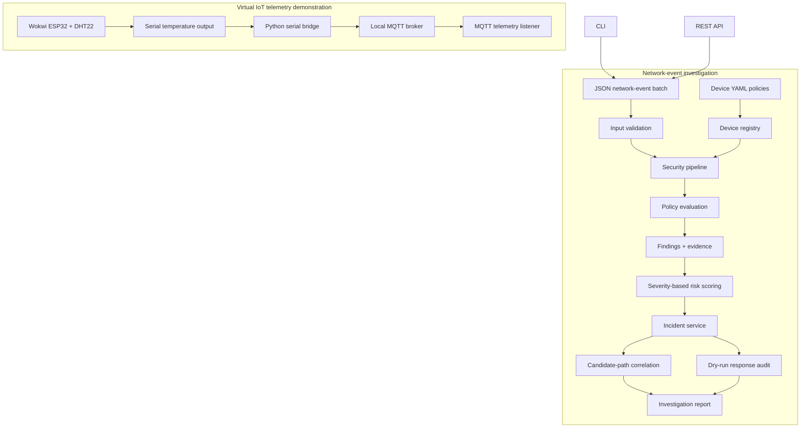

# SecureSense: Architecture and Threat Model

## 1. Purpose

This document explains the SecureSense component architecture, the flow of
network-event investigations, the virtual IoT telemetry demonstration, and
the security assumptions and limitations.

SecureSense is a portfolio engineering project. Its synthetic scenarios and
rule-based detections are useful for demonstrating application behavior, but
do not establish production detection accuracy.

## 2. System overview

SecureSense has two related but separate data flows:

1. **IoT telemetry demonstration:** virtual sensor → serial output → Python
   serial bridge → local MQTT broker → MQTT telemetry listener.
2. **Network-event investigation:** JSON network events + device policies →
   validation → policy evaluation → findings → risk assessment → incidents →
   candidate-path correlation → report and optional dry-run response audit.

The MQTT telemetry flow is not automatically converted into network-security
events for the investigation pipeline.

## 3. Architecture diagram

The diagram represents logical relationships, not a claim that the MQTT
sensor flow feeds the investigation pipeline directly.

## 4. Main components

### Device configuration and registry

Device YAML files describe known devices and their communication policies.
The registry supplies the configured inventory used during investigations.

The policy model includes communication attributes such as protocol,
destination, port, and network zone. The registry and evaluator help distinguish
expected communication from policy violations and unknown-device activity.

### Input validation

Network events supplied as JSON or through the REST API must contain the
required event fields, including device identity, source and destination
addresses, protocol, destination port, network zone, and timestamp.

The loader and API validate inputs before they are passed to the investigation
workflow. Validation failures should be handled as invalid input rather than
treated as proof of malicious behavior.

### Security policy evaluation

The security pipeline evaluates observed events against configured policy.

- Expected communication can be allowed without generating a finding.
- A registered device communicating outside its configured policy can produce
  `NET-001`.
- An event for a device that is not registered can produce `NET-002`.

These rules are based on configured inventory and observed event fields.
They do not independently establish intent or attacker attribution.

### Findings and evidence

Findings carry rule identifiers, severity, descriptions, supporting evidence,
and recommendations. Evidence is important because a reviewer should be able
to understand which event attributes contributed to a detection.

### Risk scoring

The current scorer assigns severity-based scores. A high-severity finding in
the supplied scenarios receives 70/100.

This value is a configured risk score, not a statistically calibrated
probability that a device has been compromised.

### Incident management

The incident service creates incidents from investigation findings and risk
assessments. The lifecycle model records supported state transitions and
audit information.

Incidents and their lifecycle audit history are persisted in SQLite. The application restores saved incident state across repository reopening and API restarts.

### Candidate attack-path correlation

The correlator examines chronological network evidence for possible
relationships between findings.

In the candidate lateral-movement scenario, one event's destination address
is the next event's source address. SecureSense reports the shared address as
a candidate network relationship.

This is an investigative hypothesis. Shared IP evidence alone does not prove
lateral movement, compromise, causality, or a common attacker.

### Response audit

When requested, SecureSense records response recommendations in dry-run
mode. These records provide an audit trail of proposed investigation actions.

The current workflow does not execute firewall changes, block traffic,
isolate devices, or modify external systems.

### CLI and REST API

The CLI supports investigation report generation and MQTT telemetry listening.
The REST API exposes health, device inventory, and investigation endpoints.

The API accepts a batch of network events and returns investigation results.
It does not automatically translate MQTT sensor telemetry into network events.

## 5. Trust boundaries and data flow

### Device configuration boundary

Device YAML is configuration input. Configuration should be reviewed and
controlled because incorrect policies can change which events are allowed
or detected.

### Event input boundary

JSON files and REST API requests are external inputs to the investigation
workflow. Required fields and supported values are validated before
investigation.

The current design demonstrates application-level validation; it should not
be interpreted as a complete network-ingestion security gateway.

### MQTT boundary

The local broker configuration is intended for isolated development and
simulation. Anonymous access is not suitable for exposure to untrusted
networks.

A hardened deployment would require appropriate authentication, authorization,
transport security, secrets management, network restrictions, and monitoring.

### Response boundary

The response service records dry-run recommendations. No automatic enforcement
is performed, which limits the risk of an investigation result directly
changing industrial network state.

### Persistence boundary

Incident state, lifecycle audit history, investigations, sensor readings, and event-deduplication records are persisted in SQLite. Restart recovery has been verified locally. Production use would still require an operational backup, recovery, monitoring, and database-management plan.

## 6. Threat scenarios and detection mapping

| Scenario | Relevant behavior | Evidence and limitation |
|---|---|---|
| Registered device contacts an unapproved destination | `NET-001` | Policy mismatch; does not prove malicious intent |
| Event references an unknown device | `NET-002` | Device is absent from the configured registry |
| Events share a possible network hop | Candidate path | Correlation requires analyst validation |
| Events have unrelated endpoints | No candidate path in the supplied scenario | Demonstrates behavior for this synthetic case, not universal accuracy |
| Expected communication matches policy | Allowed event | No finding is expected for the supplied authorized case |
| Invalid event data is submitted | Input validation rejects invalid data | Validation failure is not itself a security finding |

## 7. Security assumptions

The current demonstration assumes that:

- Device configurations represent the inventory and policy intended for the test.
- Supplied event records are the evidence available to the investigation.
- Timestamps and addresses in synthetic scenarios are test data.
- Severity rules are configuration choices, not learned or calibrated probabilities.
- Analysts review candidate attack paths and recommendations before taking action.
- Local MQTT access is limited to an isolated simulation environment.

If these assumptions are not true in a real deployment, the results may be
incomplete, misleading, or inappropriate for operational response.

## 8. What SecureSense does not claim

SecureSense does not currently claim to:

- Provide production-certified industrial intrusion detection.
- Prove that a candidate path represents an actual attack.
- Identify or attribute an attacker.
- Automatically convert MQTT sensor telemetry into network-security events; telemetry and network-security events remain separate workflows.
- Execute network blocking or device isolation.
- Establish real-world detection accuracy from synthetic scenarios.
- Have a verified hosted GitHub Actions result before the workflow is run.

## 9. Production-oriented next steps

Before considering operational deployment, the following areas would need
additional design, implementation, and validation:

1. Authenticate and authorize MQTT clients; secure broker transport and secrets.
2. Define a durable incident store, retention policy, backup, and recovery process.
3. Integrate trusted network-event sources with explicit schemas and provenance.
4. Test against representative benign and malicious traffic, including false
   positives and false negatives.
5. Define analyst approval, authorization, rollback, and audit controls before
   implementing any active response.
6. Add operational monitoring, access controls, deployment hardening, and
   incident-response procedures.
7. Review dependencies and validate the complete deployment pipeline.

These are future work items, not features claimed to be implemented.

## 10. Related documentation

- [Project README](../README.md)
- [Project build and validation journey](PROJECT_BUILD_AND_VALIDATION.md)
- [Release checklist](RELEASE_CHECKLIST.md)
